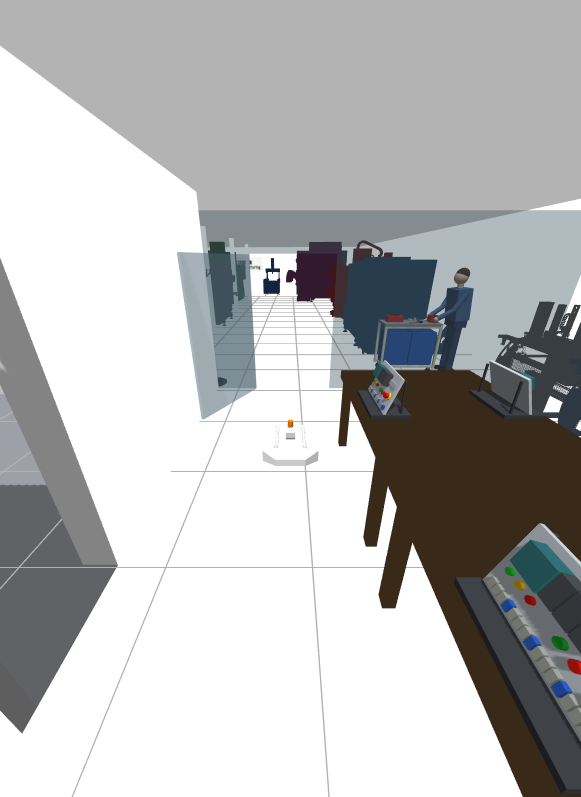

# Simulador del taller Gene Haas de IQS para el SocialTech Challenge 2027

Simulador en Gazebo del taller Gene Haas de IQS, con el robot Tracer2 listo para usar desde ROS 2. Incluye la sala de máquinas, la sala de células y el robot con LiDAR 2D, IMU y odometría.

El simulador no incluye mapeo, localización ni navegación: cada equipo los aporta con su propio software.

¿Tenéis Ubuntu 24.04 pero todavía no habéis instalado ROS 2? Seguid la [guía de inicio](docs/GUIA_INICIO.md), que explica cada paso desde cero.

## Requisitos

- Ubuntu 24.04. En Windows, podéis instalarlo en una máquina virtual de VirtualBox.
- ROS 2 Jazzy, siguiendo la guía oficial: <https://docs.ros.org/en/jazzy/Installation/Ubuntu-Install-Debs.html>.

Con ROS 2 Jazzy instalado, añadid las dependencias del simulador:

```bash
sudo apt update
sudo apt install git python3-colcon-common-extensions ros-jazzy-desktop ros-jazzy-ros-gz ros-jazzy-xacro ros-jazzy-teleop-twist-keyboard
```

## Clonar, compilar y arrancar

Desde la carpeta donde queráis guardar el simulador:

```bash
git clone https://github.com/alexllambrichcastells/socialtech-gene-haas-sim.git
cd socialtech-gene-haas-sim/ros2_ws
source /opt/ros/jazzy/setup.bash
colcon build --symlink-install
source install/setup.bash
ros2 launch gene_haas_bringup gene_haas_tracer2.launch.py
```

Al iniciar la simulación, el Tracer2 aparece en el punto 1, la salida del circuito, en la sala de células, orientado hacia la puerta de cristal.



Para volver a arrancar no hace falta compilar: en una terminal nueva, desde `ros2_ws`, repetid los dos `source` y el `ros2 launch`. Para cerrar, pulsad `Ctrl+C` en la terminal del simulador.

## Más información

- [`docs/GUIA_INICIO.md`](docs/GUIA_INICIO.md): instalación desde cero, descarga con ZIP, terminales y cierre.
- [`ros2_ws/README.md`](ros2_ws/README.md): tópicos del robot, teleoperación por teclado, validación y ajustes para VirtualBox.

## Recursos de terceros

- El Tracer2 se ha adaptado del simulador [SocialTech-Gazebo](https://github.com/SocialTech-Challenge/SocialTech-Gazebo), con licencia BSD.
- Las mallas de las máquinas Haas y de las células SMC son modelos CAD de sus fabricantes.
- El logotipo del cartel es una marca registrada de Haas Automation.
