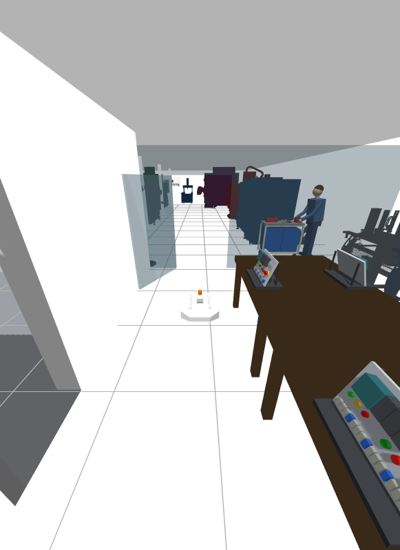

# Guía de inicio: del Ubuntu recién instalado al simulador en marcha

Esta guía es para quien tiene Ubuntu 24.04 y todavía no ha instalado ROS 2. Si ya tenéis ROS 2 Jazzy, id directamente al [README principal](../README.md).

Todos los comandos se escriben en una terminal de Ubuntu (`Ctrl+Alt+T`). Una terminal nueva se abre siempre en vuestra carpeta personal (`~`).

## 1. Instalar ROS 2 Jazzy

Seguid la guía oficial de instalación con paquetes Debian: <https://docs.ros.org/en/jazzy/Installation/Ubuntu-Install-Debs.html>.

La guía tiene varios bloques: configurar el idioma (locale), activar los repositorios de ROS 2 e instalar los paquetes. Cuando os haga elegir, instalad la versión de escritorio, `ros-jazzy-desktop`. Podéis ejecutar sus comandos desde cualquier carpeta.

Comprobad que ha ido bien:

```bash
source /opt/ros/jazzy/setup.bash
ros2 --help
```

Si aparece la ayuda de `ros2`, ROS 2 está instalado.

## 2. Instalar las dependencias del simulador

Desde cualquier carpeta:

```bash
sudo apt update
sudo apt install git python3-colcon-common-extensions ros-jazzy-desktop ros-jazzy-ros-gz ros-jazzy-xacro ros-jazzy-teleop-twist-keyboard
```

Con esto se instala también Gazebo Harmonic. Comprobadlo:

```bash
source /opt/ros/jazzy/setup.bash
gz sim --version
```

Debe indicar `Gazebo Sim, version 8.x`.

## 3. Descargar el simulador

Elegid una de las dos opciones.

**Con git.** Desde la carpeta personal, que es donde se abre la terminal:

```bash
git clone https://github.com/alexllambrichcastells/socialtech-gene-haas-sim.git
cd socialtech-gene-haas-sim/ros2_ws
```

**Con el ZIP de GitHub.** En la página del repositorio, pulsad **Code → Download ZIP** y extraed el archivo. Se crea una carpeta llamada `socialtech-gene-haas-sim-main`: el final del nombre es el de la rama. Si lo extraéis en `Descargas` (`Downloads` si Ubuntu está en inglés), entrad así:

```bash
cd ~/Descargas/socialtech-gene-haas-sim-main/ros2_ws
```

Si la ruta tiene espacios, poned entre comillas la parte que va después de `~/`, por ejemplo `cd ~/"Mis pruebas/socialtech-gene-haas-sim-main/ros2_ws"`. El simulador funciona en carpetas con espacios.

A partir de aquí, todos los comandos del proyecto se ejecutan **dentro de la carpeta `ros2_ws`**.

## 4. Compilar (solo la primera vez)

En la carpeta `ros2_ws`:

```bash
source /opt/ros/jazzy/setup.bash
colcon build --symlink-install
```

Termina con `Summary: 2 packages finished`. Solo hay que repetirlo si actualizáis el simulador (un `git pull` o un ZIP nuevo).

## 5. Arrancar

**Terminal 1**, en la carpeta `ros2_ws`:

```bash
source /opt/ros/jazzy/setup.bash
source install/setup.bash
ros2 launch gene_haas_bringup gene_haas_tracer2.launch.py
```

- El primer `source` activa ROS 2 y el segundo, el simulador. Hay que hacerlos en cada terminal nueva desde la que lancéis algo del proyecto.
- Se abre la ventana de Gazebo con el taller y, unos segundos después, aparece el Tracer2. Los primeros segundos la simulación va lenta mientras carga.
- Dejad esta terminal abierta mientras uséis el simulador.

Al iniciar la simulación, el Tracer2 aparece en el punto 1, la salida del circuito, en la sala de células, orientado hacia la puerta de cristal.



## 6. Mover el robot con el teclado

**Terminal 2**, desde cualquier carpeta. La teleoperación es un paquete de ROS 2, así que basta con el primer `source`:

```bash
source /opt/ros/jazzy/setup.bash
ros2 run teleop_twist_keyboard teleop_twist_keyboard
```

Dejad el foco en esta terminal y pulsad `i`: el robot avanza hacia la puerta de cristal. Con `k` se para. El resto de teclas y los tópicos del robot están en la [documentación técnica](../ros2_ws/README.md).

## 7. Cerrar

1. `Ctrl+C` en la terminal 2.
2. `Ctrl+C` en la terminal 1. Gazebo tarda unos segundos en cerrarse; esperad a que vuelva el prompt.

Al cerrar puede aparecer un mensaje `process has died [... exit code -11 ...]` del servidor de Gazebo. Es normal y no indica ningún problema.

## 8. Volver a arrancar otro día

No hace falta volver a compilar. Abrid una terminal, entrad en `ros2_ws` y repetid el paso 5:

```bash
cd ~/socialtech-gene-haas-sim/ros2_ws        # o la carpeta donde extrajisteis el ZIP
source /opt/ros/jazzy/setup.bash
source install/setup.bash
ros2 launch gene_haas_bringup gene_haas_tracer2.launch.py
```

## Si algo falla

- **La ventana sale negra o el LiDAR marca 0,10 m en todas las direcciones.** Suele pasar en máquinas virtuales. Mirad el apartado de VirtualBox en la [documentación técnica](../ros2_ws/README.md).
- **`ros2: orden no encontrada` o `Package 'gene_haas_bringup' not found`.** Falta algún `source` en esa terminal, o no estáis en la carpeta `ros2_ws`.
- **No aparece el robot.** Esperad unos segundos. En la terminal 1 debe aparecer `Entity creation successful`.
